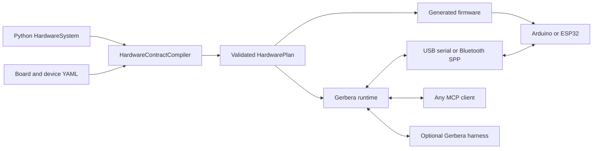

# Gerbera

[](https://github.com/BaronLiu1993/gerbera/actions/workflows/run-tests.yml)


**Declare hardware in Python, generate validated microcontroller firmware, and
expose it to agents through MCP.**

Gerbera uses one hardware declaration to generate firmware and construct a
local [Model Context Protocol](https://modelcontextprotocol.io/) server. Device
wiring, firmware commands, runtime tools, events, reactions, cameras, and model
inference all share the same validated contract.

> [!IMPORTANT]
> Gerbera is in early development. APIs, configuration formats, and generated
> firmware contracts may change between releases.

## Contents

- [Why Gerbera](#why-gerbera)
- [How it works](#how-it-works)
- [Requirements](#requirements)
- [Installation](#installation)
- [Quick start](#quick-start)
- [Supported hardware](#supported-hardware)
- [Models](#models)
- [Bluetooth runtime](#bluetooth-runtime)
- [CLI](#cli)
- [Documentation](#documentation)
- [Development](#development)
- [Contributing](#contributing)
- [License](#license)

## Why Gerbera

- **One source of truth.** A typed `HardwareSystem` describes boards, wiring,
  cameras, models, and movement systems.
- **Generated firmware.** Gerbera validates pin capabilities and creates an
  Arduino sketch for each configured microcontroller.
- **Generated MCP tools.** Declared device commands become tools that any MCP
  client can discover and call.
- **Confirmed commands.** State-changing calls wait for acknowledgements from
  the board instead of reporting success after a transport write.
- **Host-side intelligence.** Cameras, object detection, segmentation, depth
  estimation, vision-language models, and movement run alongside the hardware
  server.
- **Local automation.** Persistent reactions connect hardware events to Gerbera
  tools without requiring a particular agent harness.
- **Replaceable clients.** The included harness is optional; the SDK remains a
  standalone MCP server.

## How it works



`HardwareContractCompiler` resolves board definitions, device definitions,
wiring, commands, event routes, and transports into an immutable plan. Firmware
generation and the live runtime consume that same plan, preventing the two
sides from silently drifting apart.

At startup, the SDK validates the declaration, prepares stream storage, and
verifies firmware against a live board handshake. A contract mismatch, unknown
identity or broken connection fails startup. Generating, compiling and uploading
firmware are explicit SDK operations; startup never changes installed firmware.

### Ownership

| Component | Owns | Does not own |
| --- | --- | --- |
| CLI | Deployment metadata, service launch/stop, readiness polling and logs | Hardware/model validation, firmware, schemas, agent execution |
| SDK | Hardware declarations, validation, firmware generation/compilation/upload/verification, connections, stream schemas and hardware readiness | Harness configuration or agent workflows |
| Harness | Models, workflows, tools, connector readiness and run lifecycle | SDK imports, board connections or firmware uploads |
| Firmware | Physical I/O, component checks and watchdog safe-stop | Host-side workflow decisions |
| `gerbera_protocol` | Versioned JSON wire contracts | Service orchestration or runtime objects |

The harness talks to the SDK over MCP, including when they run on different
machines. The CLI is not in the command path after service startup. Legacy agent
orchestration lives under `gerbera_harness/runtime/`; memory only stores state and
runtime projections rebuild derived views.

## Requirements

Required:

- Python 3.12
- [arduino-cli](https://arduino.github.io/arduino-cli/) available on `PATH`
- A supported Arduino or ESP32 board
- A USB connection for initial firmware upload

Required by the standard local deployment:

- Docker
- Docker access to GitHub Container Registry

Docker runs PostgreSQL and the optional agent harness. The standalone SDK can
instead be embedded with `GerberaRuntime`, provided a compatible PostgreSQL
database is supplied.

## Installation

Gerbera is currently installed from source:

```bash
git clone https://github.com/BaronLiu1993/gerbera.git
cd gerbera

python3.12 -m venv .venv
source .venv/bin/activate
python -m pip install --upgrade pip
python -m pip install -e .
```

On Windows, activate the environment with:

```powershell
.venv\Scripts\Activate.ps1
```

## Quick start

### 1. Initialize the project

Connect a supported board over USB and run:

```bash
gerbera init
```

The CLI delegates board discovery and hardware scaffolding to the SDK. It creates
a deployment-only `gerbera.yaml`, scoped service credentials, and a local
`.gerbera/` workspace. The SDK creates `index.py` and
`.gerbera/sdk/runtime.json`, retaining each selected board's identity and explicit
watchdog settings. If more than one board is connected, the SDK asks which boards
to include. Harness setup, when selected, is handled by the harness itself.

### 2. Declare the hardware

Open the generated `index.py` and add components to the scaffolded controller:

```python
from gerbera_sdk.models.hardware.connection import Connection


status_led = Connection(
    name="status_led",
    component_type="led",
    pins={"out": "13"},
    description="Built-in status LED",
)

controller_1.connections.append(status_led)
```

To include the optional agent harness during initialization, run:

```bash
gerbera init --with-harness
```

### 3. Start Gerbera

```bash
gerbera up
```

The CLI starts PostgreSQL and the SDK, then waits for the SDK's `/ready` report.
Inside SDK startup, hardware is validated, storage becomes available, stream
tables are prepared, firmware is verified, and board/camera/model/event
runtimes start. Only then does the CLI start the optional harness and wait for its
readiness. A failed launch rolls back only services started by that invocation;
database volumes are retained.

`/health` means the service is alive; `/ready` means its configured dependencies
are usable. The SDK also publishes readiness as `gerbera://readiness`. The harness
checks this report over MCP instead of inferring hardware readiness from an open
port. Neither liveness nor readiness asserts that external model credentials have
been accepted by a model provider.

Use the lifecycle commands to inspect and stop the stack:

```bash
gerbera status
gerbera logs --follow
gerbera doctor
gerbera down
```

Advanced commands remain available when only one layer is needed:

```bash
gerbera up --no-harness
gerbera server
```

The MCP endpoint is available at `http://localhost:8001/mcp` by default.
Compatible clients can discover generated hardware tools, call them, and receive
board-confirmed results.

### Run services independently

The SDK performs the same mandatory preparation without the CLI:

```bash
python -m gerbera_sdk.server serve --config .gerbera/sdk/runtime.json
```

Its `check` subcommand validates SDK configuration and hardware without starting
connections or uploading firmware. The optional harness has its own entry point:

```bash
GERBERA_HARNESS_CONFIG=.gerbera/harness/harness.json \\
MCP_URL=http://localhost:8001/mcp \\
uvicorn gerbera_harness.bootstrap:create_server_app --factory --port 8000
```

For API models, provide the configured API-key environment variable to the harness
process. Docker deployments receive only their scoped environment files. SDK
credentials contain writer/schema-owner passwords, not database-admin or model
credentials. CLI status, logs and shutdown do not load service secrets.

In `gerbera.yaml`, set a service's `kind: external` and its reachable `url` to use
an independently managed service. The CLI waits for external SDK/harness readiness
but never starts or stops those services. Deployment URLs supply managed-service
endpoints; `MCP_URL` overrides the harness connector setting.

Deployment kinds are explicit: `process` is a local SDK process and requires a
configuration path; `container` requires an image, container port and published
URL port; `external` accepts an endpoint without local execution settings. SDK
process environment files are loaded in order, then overridden by explicit
`environment` entries and deployment database endpoints. Container configuration
mounts require `config_environment`; persistent volumes require `volume_target`.
Legacy `managed` settings must be replaced with the corresponding `kind`.

Older combined project manifests must be split before using the new CLI: retain
hardware settings in the SDK config, put model/workflow settings in the harness
config, and leave only `services` and launch settings in `gerbera.yaml`. The SDK
accepts only its current flat configuration schema: `project_root`, `entry_point`,
`hardware_variable`, service settings, `secrets_file`, and `devices`. Combined
manifests and retired aliases are rejected. SDK secret files contain only the two
SDK database role passwords. Existing database volumes are never replaced automatically.

When working from an unreleased checkout, use container images built from the
same revision; published `latest` images may not include the current readiness
contract. The harness image can be rebuilt with
`docker build -f .docker/harness/Dockerfile -t ghcr.io/baronliu1993/gerbera:latest .`.

## Supported hardware

### Boards

| Board | FQBN | Runtime transports |
| --- | --- | --- |
| Arduino Uno | `arduino:avr:uno` | USB serial |
| Arduino Mega | `arduino:avr:mega` | USB serial |
| ESP32 Dev Module | `esp32:esp32:esp32` | USB serial, Bluetooth Classic SPP |

### Device definitions

Gerbera currently includes configuration-driven support for:

- LEDs
- HC-SR04 ultrasonic sensors
- HW-201 and KY-033 infrared sensors
- DC motors
- SG90 and MG996R servos

Device behavior is defined in
[`src/gerbera_sdk/firmware/devices/configs/`](src/gerbera_sdk/firmware/devices/configs/).
Adding a device definition supplies its pin contract, commands, state, firmware
handlers, and validation rules.

## Models

Local neural-network models live in named subfolders:

```text
.gerbera/models/<model-name>/
├── model.yaml
└── model.onnx
```

Code refers only to the subfolder name. `model.yaml` declares the model format,
weights filename, input shape, and output contract. Gerbera validates the
manifest and selects the matching adapter.

Supported local adapters include:

| Task | Formats |
| --- | --- |
| Object detection | YOLOv5 |
| Object segmentation | YOLOv5 Seg, YOLOv8 Seg |
| Depth estimation | MiDaS, Depth Anything |

Vision-language adapters are available for OpenAI, Anthropic, and Google
models. Camera and inference data remain on the host; they do not pass through
the microcontroller serial protocol.

## Bluetooth runtime

The ESP32 Dev Module can use Bluetooth Classic SPP for runtime commands while
USB remains the firmware upload connection.

```json
{
  "devices": {
    "esp32-1": {
      "id": "esp32-1",
      "address": "/dev/cu.usbserial-0001",
      "runtime_transport": {
        "kind": "bluetooth_classic",
        "port": "/dev/cu.Gerbera-ESP32",
        "device_name": "Gerbera-ESP32"
      }
    }
  }
}
```

Flash firmware over USB once, pair the ESP32 with the host, and then start the
server using the paired serial endpoint. Bluetooth support does not provide OTA
firmware updates.

## CLI

The optional harness uses JSON-defined workflows with replaceable node strategies,
fixed entry and exit boundaries, and a REST run API. It connects to the SDK over
MCP and can run on a different machine. See the
[harness guide](src/gerbera_harness/README.md) for configuration and extension examples.

| Command | Purpose |
| --- | --- |
| `gerbera init` | Create the project configuration and `.gerbera/` workspace |
| `gerbera up` | Launch services in dependency order and wait for readiness |
| `gerbera server` | Launch the SDK in the foreground with mandatory SDK preparation |
| `gerbera status` | Show service readiness and database process status |
| `gerbera doctor` | Request service-owned readiness reports |
| `gerbera logs --follow` | Follow managed service logs |
| `gerbera down` | Stop managed services without deleting data |

Use `gerbera --help` or `gerbera <command> --help` for the installed command
reference. Firmware generation, compilation and uploading use the explicit
[SDK firmware APIs](src/gerbera_sdk/firmware/README.md). Startup always verifies
the installed firmware and fails if it does not match the hardware configuration.

## Documentation

- [SDK overview](src/gerbera_sdk/README.md)
- [Hardware declarations and validation](src/gerbera_sdk/models/hardware/README.md)
- [Runtime architecture](src/gerbera_sdk/models/runtime/README.md)
- [Firmware generation](src/gerbera_sdk/firmware/README.md)
- [Events and persistence](src/gerbera_sdk/events/README.md)
- [Reactions](src/gerbera_sdk/events/reactions/README.md)
- [Optional agent harness](src/gerbera_harness/README.md)
- [Test organization](tests/README.md)

## Development

Install the development dependencies and run the complete test suite:

```bash
python -m pip install -e ".[dev]"
python -m pytest
```

The same test command runs in GitHub Actions on every push and pull request.

## Contributing

Issues and pull requests are welcome while the public contribution guide is
being prepared. Before submitting a change:

1. Keep SDK hardware behavior independent from the optional harness.
2. Add or update tests for behavior that changes.
3. Run `python -m pytest` locally.
4. Explain user-visible contract or firmware changes in the pull request.

Use [GitHub Issues](https://github.com/BaronLiu1993/gerbera/issues) for bug
reports and feature proposals.

## License

Gerbera does not currently declare an open-source license. Until a license is
added, standard copyright restrictions apply.
