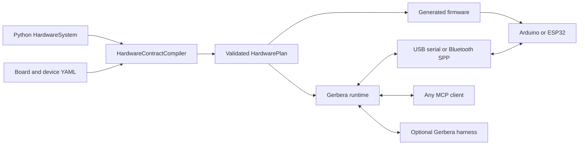

# Gerbera

[](https://github.com/BaronLiu1993/gerbera/actions/workflows/run-tests.yml)


**Declare hardware in Python, generate validated microcontroller firmware, and
expose it to agents through MCP.**

Gerbera uses one hardware declaration to generate firmware and construct a
local [Model Context Protocol](https://modelcontextprotocol.io/) server. Device
wiring, firmware commands, runtime tools, events, reactions, cameras, and model
inference all share the same validated contract.

> [!IMPORTANT]
> Gerbera is in early development. APIs, configuration formats, and generated
> firmware contracts may change between releases.

## Contents

- [Why Gerbera](#why-gerbera)
- [How it works](#how-it-works)
- [Requirements](#requirements)
- [Installation](#installation)
- [Quick start](#quick-start)
- [Supported hardware](#supported-hardware)
- [Models](#models)
- [Bluetooth runtime](#bluetooth-runtime)
- [CLI](#cli)
- [Documentation](#documentation)
- [Development](#development)
- [Contributing](#contributing)
- [License](#license)

## Why Gerbera

- **One source of truth.** A typed `HardwareSystem` describes boards, wiring,
  cameras, models, and movement systems.
- **Generated firmware.** Gerbera validates pin capabilities and creates an
  Arduino sketch for each configured microcontroller.
- **Generated MCP tools.** Declared device commands become tools that any MCP
  client can discover and call.
- **Confirmed commands.** State-changing calls wait for acknowledgements from
  the board instead of reporting success after a transport write.
- **Host-side intelligence.** Cameras, object detection, segmentation, depth
  estimation, vision-language models, and movement run alongside the hardware
  server.
- **Local automation.** Persistent reactions connect hardware events to Gerbera
  tools without requiring a particular agent harness.
- **Replaceable clients.** The included harness is optional; the SDK remains a
  standalone MCP server.

## How it works



`HardwareContractCompiler` resolves board definitions, device definitions,
wiring, commands, event routes, and transports into an immutable plan. Firmware
generation and the live runtime consume that same plan, preventing the two
sides from silently drifting apart.

At startup, Gerbera verifies the connected board identity, protocol version,
and contract digest. Firmware that does not match the current declaration is
rejected before hardware commands are accepted.

## Requirements

Required:

- Python 3.12
- [arduino-cli](https://arduino.github.io/arduino-cli/) available on `PATH`
- A supported Arduino or ESP32 board
- A USB connection for initial firmware upload

Required by the standard local deployment:

- Docker
- Docker access to GitHub Container Registry

Docker runs PostgreSQL and the optional agent harness. The standalone SDK can
instead be embedded with `GerberaRuntime`, provided a compatible PostgreSQL
database is supplied.

## Installation

Gerbera is currently installed from source:

```bash
git clone https://github.com/BaronLiu1993/gerbera.git
cd gerbera

python3.12 -m venv .venv
source .venv/bin/activate
python -m pip install --upgrade pip
python -m pip install -e .
```

On Windows, activate the environment with:

```powershell
.venv\Scripts\Activate.ps1
```

## Quick start

### 1. Declare the hardware

Create `index.py`. Replace the serial port with the upload port reported by
`arduino-cli board list`.

```python
from gerbera_sdk.models.hardware.connection import Connection
from gerbera_sdk.models.hardware.hardware_system import HardwareSystem
from gerbera_sdk.models.hardware.microcontroller import (
    Microcontroller,
    RuntimeWatchdogConfig,
)


status_led = Connection(
    name="status_led",
    component_type="led",
    pins={"out": "13"},
    description="Built-in status LED",
)

controller = Microcontroller(
    name="controller",
    port="/dev/cu.usbmodem101",
    fqbn="arduino:avr:uno",
    watchdog=RuntimeWatchdogConfig(
        heartbeat_interval_ms=500,
        heartbeat_timeout_ms=2500,
    ),
    connections=[status_led],
)

hardware_system = HardwareSystem(
    name="hello-gerbera",
    description="A Gerbera-controlled status LED",
    microcontrollers=[controller],
)
```

### 2. Initialize the project

Connect the board over USB and run:

```bash
gerbera init
```

Select the connected board, keep `index.py` as the entry point, and use
`hardware_system` as the hardware variable. Initialization creates
`config.json` and the local `.gerbera/` workspace. It currently also collects
credentials for the optional harness.

### 3. Generate and flash firmware

```bash
gerbera firmware flash
```

Gerbera installs the required Arduino cores and libraries, validates the
hardware contract, generates the sketch, and uploads it. Later runs skip boards
whose installed contract is already current. Force an upload with:

```bash
gerbera firmware flash --force
```

### 4. Start local services

```bash
gerbera up
```

Choose `local` when prompted. This starts PostgreSQL and the optional harness
with Docker.

### 5. Start the MCP hardware server

```bash
gerbera server
```

The MCP endpoint is available at `http://localhost:8001/mcp`. Compatible clients
can discover the generated LED tool, call it, and receive the board-confirmed
result.

## Supported hardware

### Boards

| Board | FQBN | Runtime transports |
| --- | --- | --- |
| Arduino Uno | `arduino:avr:uno` | USB serial |
| Arduino Mega | `arduino:avr:mega` | USB serial |
| ESP32 Dev Module | `esp32:esp32:esp32` | USB serial, Bluetooth Classic SPP |

### Device definitions

Gerbera currently includes configuration-driven support for:

- LEDs
- HC-SR04 ultrasonic sensors
- HW-201 and KY-033 infrared sensors
- DC motors
- SG90 and MG996R servos

Device behavior is defined in
[`src/gerbera_sdk/firmware/devices/configs/`](src/gerbera_sdk/firmware/devices/configs/).
Adding a device definition supplies its pin contract, commands, state, firmware
handlers, and validation rules.

## Models

Local neural-network models live in named subfolders:

```text
.gerbera/models/<model-name>/
├── model.yaml
└── model.onnx
```

Code refers only to the subfolder name. `model.yaml` declares the model format,
weights filename, input shape, and output contract. Gerbera validates the
manifest and selects the matching adapter.

Supported local adapters include:

| Task | Formats |
| --- | --- |
| Object detection | YOLOv5 |
| Object segmentation | YOLOv5 Seg, YOLOv8 Seg |
| Depth estimation | MiDaS, Depth Anything |

Vision-language adapters are available for OpenAI, Anthropic, and Google
models. Camera and inference data remain on the host; they do not pass through
the microcontroller serial protocol.

## Bluetooth runtime

The ESP32 Dev Module can use Bluetooth Classic SPP for runtime commands while
USB remains the firmware upload connection.

```json
{
  "devices": {
    "esp32-1": {
      "id": "esp32-1",
      "address": "/dev/cu.usbserial-0001",
      "runtime_transport": {
        "kind": "bluetooth_classic",
        "port": "/dev/cu.Gerbera-ESP32",
        "device_name": "Gerbera-ESP32"
      }
    }
  }
}
```

Flash firmware over USB once, pair the ESP32 with the host, and then start the
server using the paired serial endpoint. Bluetooth support does not provide OTA
firmware updates.

## CLI

| Command | Purpose |
| --- | --- |
| `gerbera init` | Create the project configuration and `.gerbera/` workspace |
| `gerbera firmware flash` | Validate, generate, and upload changed firmware |
| `gerbera firmware flash --force` | Upload firmware regardless of its installed digest |
| `gerbera up` | Start local PostgreSQL and the optional harness |
| `gerbera server` | Start the standalone MCP hardware server |

Use `gerbera --help` or `gerbera <command> --help` for the installed command
reference. Cloud deployment and `gerbera down` are not implemented yet.

## Documentation

- [SDK overview](src/gerbera_sdk/README.md)
- [Hardware declarations and validation](src/gerbera_sdk/models/hardware/README.md)
- [Runtime architecture](src/gerbera_sdk/models/runtime/README.md)
- [Firmware generation](src/gerbera_sdk/firmware/README.md)
- [Events and persistence](src/gerbera_sdk/events/README.md)
- [Reactions](src/gerbera_sdk/events/reactions/README.md)
- [Optional agent harness](src/gerbera_harness/README.md)
- [Test organization](tests/README.md)

## Development

Install the development dependencies and run the complete test suite:

```bash
python -m pip install -e ".[dev]"
python -m pytest
```

The same test command runs in GitHub Actions on every push and pull request.

## Contributing

Issues and pull requests are welcome while the public contribution guide is
being prepared. Before submitting a change:

1. Keep SDK hardware behavior independent from the optional harness.
2. Add or update tests for behavior that changes.
3. Run `python -m pytest` locally.
4. Explain user-visible contract or firmware changes in the pull request.

Use [GitHub Issues](https://github.com/BaronLiu1993/gerbera/issues) for bug
reports and feature proposals.

## License

Gerbera does not currently declare an open-source license. Until a license is
added, standard copyright restrictions apply.
