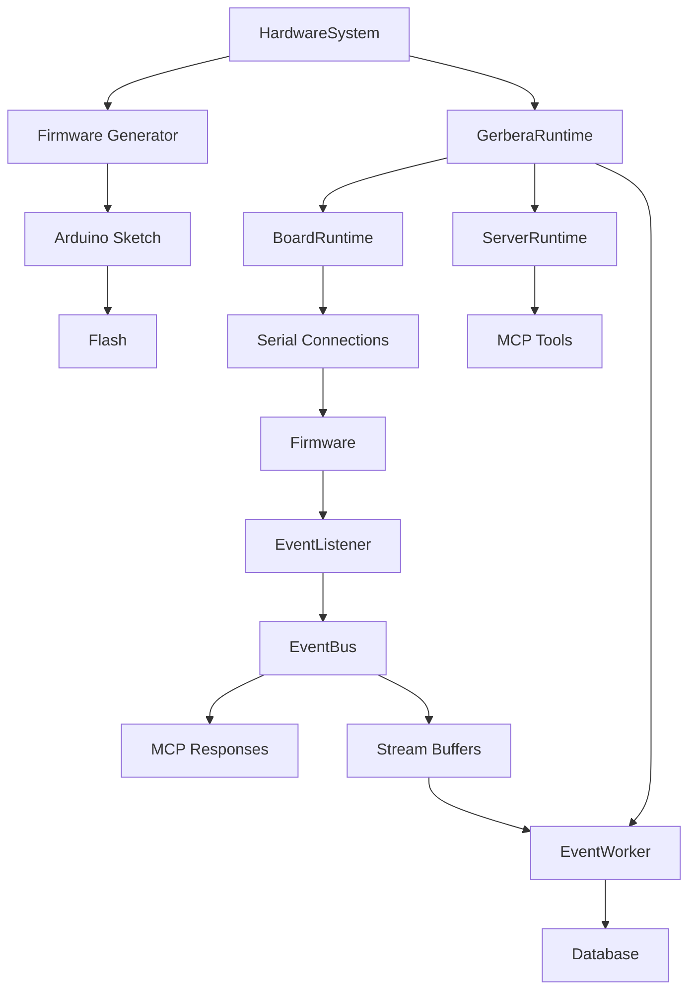

# Gerbera SDK

The SDK owns the hardware declaration model, firmware generation and flashing, and the runtime that exposes declared devices over MCP.

It is the layer that turns a declared hardware system into:

- generated firmware
- flashed microcontrollers
- serial command execution
- MCP tool exposure
- event and stream handling

## Folders

```text
events/             Event routing, stream buffering, and event reactions.
firmware/           Firmware generation, flashing, and device builders.
models/             Hardware declarations and board, database, and server runtimes.
server/             Independent SDK entry point, SDK configuration and scaffolding.
utils.py            Cross-cutting helpers such as event naming and identifiers.
gerbera_runtime.py  Top-level composition root for setup and run.
```

## Ownership Boundary

The SDK owns:

- hardware declaration validation
- command contracts and serialization
- firmware generation and flashing
- runtime composition for board and server behavior
- MCP tool registration
- serial event ingestion
- buffered stream persistence

The SDK does not own:

- physical wiring discovery
- dashboards or UI presentation
- cloud/database provisioning outside the declared connection info
- application-specific business logic on top of device events
- harness model/workflow configuration or agent lifecycle

Wire contracts shared with remote clients live in the neutral `gerbera_protocol`
package. The SDK does not import the CLI or harness. The CLI launches it as a
separate process and waits for service-owned readiness.

## High-Level Flow



## Runtime Entry Point

Use `GerberaRuntime` in [gerbera_runtime.py](/Users/jiexuanliu/Desktop/firecracker/cli/src/gerbera_sdk/gerbera_runtime.py):

- `setup(...)`
  Validates hardware and verifies installed firmware through a live handshake.
  It does not generate, compile or upload firmware.

- `run(...)`
  Validates hardware, constructs runtimes, prepares storage, verifies firmware,
  starts dependencies, runs the MCP app, and closes resources on exit.

- `build_application(hardware, database_settings)`
  Builds the MCP application for embedding or inspection without running its server.
  `run(hardware, database_settings, **transport_options)` uses this same path.

- `generate_firmware`, `compile_firmware`, `upload_firmware`, `verify_firmware`
  Expose the four explicit firmware operations through the facade. Each operation
  validates the declaration; verification never generates or uploads firmware.

Database credentials are supplied explicitly with `DatabaseSettings` from
`models/runtime/storage/database_settings.py`. Configuration and environment loading
belong to the server entry point, outside the facade.

The independently runnable entry point owns loading and validating SDK settings
and hardware code:

```bash
python -m gerbera_sdk.server serve --config .gerbera/sdk/runtime.json
python -m gerbera_sdk.server check --config .gerbera/sdk/runtime.json
```

`check` does not connect to hardware, upload firmware or require the CLI. SDK
configuration and writer/schema-owner credentials remain on the hardware host.
The harness can run remotely with only the SDK MCP endpoint and its own secrets.

## Runtime Shape

Current runtime responsibilities are split like this:

- `BoardRuntime`
  Owns live serial connections for declared microcontrollers.

- `ServerRuntime`
  Coordinates the hardware, perception, movement, reaction and resource MCP adapters.

- `CommandExecutor`
  Owns command dispatch and executable connection actions independently of MCP.

- `EventRegistration` and `ReactionService`
  Own hardware event registration and reaction validation/restoration respectively.

- `Database`
  Owns database connection details and insert execution. `RuntimeStorage` prepares
  device stream tables as the schema-owner role before the writer starts.

- `EventWorker`
  Owns asynchronous stream write queueing and retry.

- `GerberaRuntime`
  Is the composition root that wires board, event, database, and server objects together in the right order.

- `RuntimeReadiness`
  Reports lifecycle and dependency health via HTTP `/ready` and the MCP resource
  `gerbera://readiness`. HTTP `/health` is liveness only.
