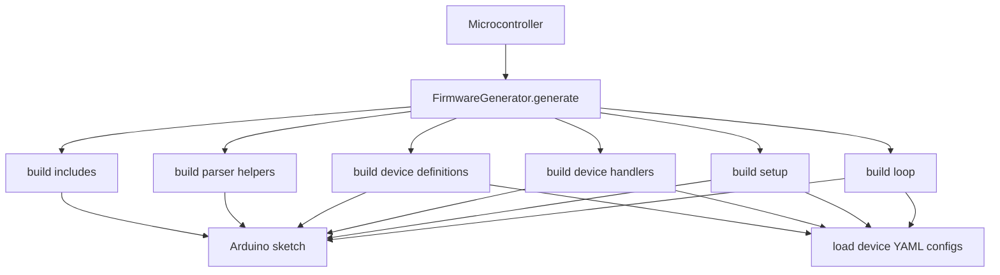

# Firmware

The firmware folder owns Arduino sketch generation, parsing code, command routing, setup generation, and flashing.

## Files

```text
configurations.py       Registry for supported devices and microcontroller packages.
firmware_generator.py   Generates Arduino runtime, component and command source; writes project files.
firmware_compiler.py    Compiles an existing generated project into a binary.
firmware_uploader.py    Uploads an existing compiled binary to the board.
firmware_verifier.py    Checks installed firmware through a live board handshake.
firmware_dependencies.py Installs Arduino cores and device libraries explicitly.
devices/                Config-driven firmware device library and YAML configs.
```

Each microcontroller gets one firmware root in the project-local Gerbera
workspace:

```text
.gerbera/
└── firmware/
    └── <microcontroller-id>/
        ├── <microcontroller-id>.ino
        └── build/
```

## Ownership

This folder owns:

- mapping `component_type` to a firmware config-backed builder
- generated Arduino includes
- generated global definitions
- generated handlers
- generated setup and loop code
- flashing firmware through Arduino tooling

This folder does not own:

- serial runtime connections
- MCP tool registration
- database write buffering
- event listener threads

## Generation Flow



## Device Configs

Each supported component has one complete YAML config under:

```text
devices/configs/<component_type>.yaml
```

Configs are intentionally self-contained. They do not inherit from, include, or
reference other component configs. The generic device library loads each config
and renders its firmware templates for a concrete connection.

## Wire Protocol

Generated firmware writes this protocol through `GERBERA_TRANSPORT`. USB
firmware binds it to `Serial`; ESP32 Bluetooth Classic firmware binds it to
`BluetoothSerial`. Device templates must not write directly to `Serial`.

Commands sent to Arduino:

```text
HANDSHAKE,__gerbera__,challenge:<nonce>
READ,<connection.name>,command_id:<id>
WRITE,<connection.name>,key:value,key:value,command_id:<id>
```

Responses emitted by Arduino:

```text
HANDSHAKE,__gerbera__,protocol:<version>,board:<id>,digest:<digest>,challenge:<nonce>
MCP,<connection.event_name>,command_id:<id>,key:value
STREAM,<connection.event_name>,key:value
```

Every command response echoes the host-generated `command_id`. The runtime uses
it to match concurrent acknowledgements and removes it before updating hardware
state or evaluating reactions. Stream events are unsolicited and therefore do
not include a command ID.

`connection.event_name` is the runtime-safe internal identifier. It is generated from:

- the connection name
- a stable hash of `microcontroller_id` and the connection name

This same identifier is reused for:

- firmware serial output
- event bus routing
- stream table naming

Pin assignments are represented separately in the board contract digest. At
startup, the runtime requires the firmware digest and board ID to exactly match
the compiled hardware plan before registering the serial connection.

SDK startup verifies the live identity, protocol and digest. Any mismatch or
handshake failure stops startup without installing dependencies, generating code,
compiling or uploading. Verification never relies on a local installed-firmware
manifest.

Firmware updates use four separate APIs. With a validated `hardware_plan`:

```python
from gerbera_sdk.firmware.firmware_compiler import FirmwareCompiler
from gerbera_sdk.firmware.firmware_dependencies import FirmwareDependencies
from gerbera_sdk.firmware.firmware_generator import FirmwareGenerator
from gerbera_sdk.firmware.firmware_uploader import FirmwareUploader
from gerbera_sdk.firmware.firmware_verifier import FirmwareVerifier
from gerbera_sdk.models.runtime.boards.board_runtime import BoardRuntime

FirmwareDependencies(hardware_plan).install()
for board in hardware_plan.boards:
    sketch_path = FirmwareGenerator(board).write_files()
    build_path = FirmwareCompiler(board).compile(sketch_path)
    FirmwareUploader(board).upload(build_path)
FirmwareVerifier(BoardRuntime(hardware_plan)).verify()
```

`generate()` returns source text without writing files. `write_files()` saves the
generated project and returns its sketch path. Compilation does not upload, and
uploading does not generate or compile. The uploader uses the configured upload
port; verification uses the configured runtime transport.

## Reaction

Keep generated firmware thin. It should parse command strings, touch hardware, and emit structured serial lines.
