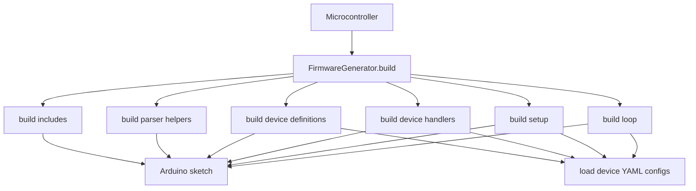

# Firmware

The firmware folder owns Arduino sketch generation, parsing code, command routing, setup generation, and flashing.

## Files

```text
configurations.py       Registry for supported devices and microcontroller packages.
firmware_generator.py   Assembles complete Arduino sketches.
flash.py                Compiles/uploads generated sketches.
devices/                Config-driven firmware device library and YAML configs.
```

Each microcontroller gets one firmware root in the project-local Gerbera
workspace:

```text
.gerbera/
└── firmware/
    └── <microcontroller-id>/
        ├── <microcontroller-id>.ino
        └── build/
```

## Ownership

This folder owns:

- mapping `component_type` to a firmware config-backed builder
- generated Arduino includes
- generated global definitions
- generated handlers
- generated setup and loop code
- flashing firmware through Arduino tooling

This folder does not own:

- serial runtime connections
- MCP tool registration
- database write buffering
- event listener threads

## Generation Flow



## Device Configs

Each supported component has one complete YAML config under:

```text
devices/configs/<component_type>.yaml
```

Configs are intentionally self-contained. They do not inherit from, include, or
reference other component configs. The generic device library loads each config
and renders its firmware templates for a concrete connection.

## Wire Protocol

Generated firmware writes this protocol through `GERBERA_TRANSPORT`. USB
firmware binds it to `Serial`; ESP32 Bluetooth Classic firmware binds it to
`BluetoothSerial`. Device templates must not write directly to `Serial`.

Commands sent to Arduino:

```text
HANDSHAKE,__gerbera__,challenge:<nonce>
READ,<connection.name>,command_id:<id>
WRITE,<connection.name>,key:value,key:value,command_id:<id>
```

Responses emitted by Arduino:

```text
HANDSHAKE,__gerbera__,protocol:<version>,board:<id>,digest:<digest>,challenge:<nonce>
MCP,<connection.event_name>,command_id:<id>,key:value
STREAM,<connection.event_name>,key:value
```

Every command response echoes the host-generated `command_id`. The runtime uses
it to match concurrent acknowledgements and removes it before updating hardware
state or evaluating reactions. Stream events are unsolicited and therefore do
not include a command ID.

`connection.event_name` is the runtime-safe internal identifier. It is generated from:

- the connection name
- a stable hash of `microcontroller_id` and the connection name

This same identifier is reused for:

- firmware serial output
- event bus routing
- stream table naming

Pin assignments are represented separately in the board contract digest. At
startup, the runtime requires the firmware digest and board ID to exactly match
the compiled hardware plan before registering the serial connection.

SDK startup owns firmware reconciliation, including when the SDK runs without
the CLI. It reads the live identity/protocol/digest rather than trusting
`installed.json`. A recognized board with an outdated contract is compiled,
uploaded and checked again before connections start. Dependencies are installed
only when missing and an update is required.

A timeout is not evidence of outdated firmware. First-time SDK initialization
records explicit permission for the selected board ID, FQBN and USB upload port in
`provisioning.json`. That permission is consumed immediately before upload, not
during dependency installation or compilation. Other transport/identity failures
fail startup without uploading. After a failed upload, check the physical board
and rerun `python -m gerbera_sdk.server initialise` on the SDK host to explicitly
authorize another initial upload; existing source/configuration is not replaced.
CLI firmware commands and force/skip-flash options are intentionally absent.

## Reaction

Keep generated firmware thin. It should parse command strings, touch hardware, and emit structured serial lines.
