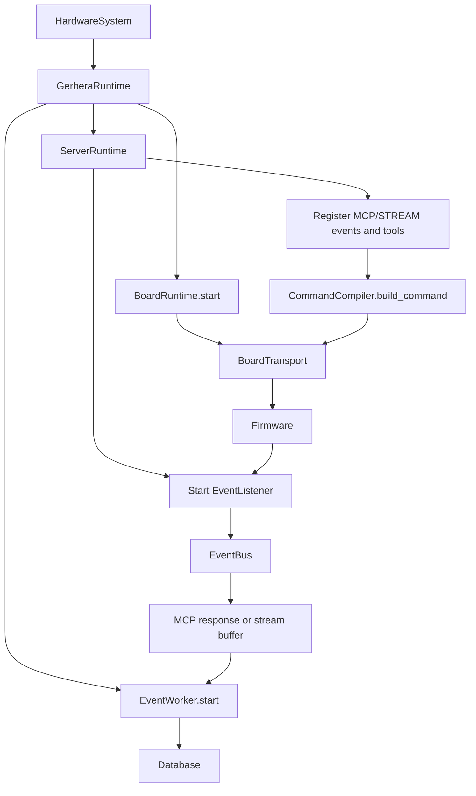

# Runtime

The runtime folder owns the live server process around the declared hardware graph.

It is responsible for:

- opening and closing serial connections
- registering MCP tools
- translating command specs into wire commands
- registering MCP and STREAM events
- starting and stopping listener threads
- coordinating stream flushing and database writes

It is not responsible for:

- defining the hardware graph itself
- device-specific firmware behavior
- pin modeling
- board/package metadata for compilation

## Boundaries

```text
boards/
    board_runtime.py            Board sessions, handshake and transport lifecycle.
    board_transport.py          Serial and Bluetooth transport implementations.
    serial_protocol.py          Wire message encoding and decoding.
commands/
    command_runtime.py          Command compilation and response parsing.
    command_response.py  Pending command correlation and completion.
    command_executor.py         Command execution and executable connection actions.
    connection_control.py       State changes and stream shutdown/draining.
perception/
    camera_runtime.py           Camera capture, latest-frame cache and lifecycle.
    model_runtime.py            Inference registration, output state and lifecycle.
movement/
    movement_runtime.py         Joint state, kinematics and motor coordination.
state/
    hardware_runtime.py         Connection state storage and snapshots.
storage/
    storage.py                  Stream schemas and bounded database startup wait.
server/
    server_runtime.py           Composes MCP capability adapters.
    hardware_tools.py           Hardware tool registration.
    perception_tools.py         Camera and inference tool registration.
    movement_tools.py           Movement tool registration.
    reaction_tools.py           Reaction tool registration.
    runtime_resources.py        MCP resources and state tools.
    tool_registry.py            MCP registration and reaction action exposure.
    runtime_lifecycle.py        SDK preparation, resource startup and cleanup.
    readiness.py                Live dependency readiness reports.
```

`GerberaRuntime` composes the capabilities. `RuntimeLifecycle` owns their startup
order. MCP adapters expose services without owning their execution or persistence.
Hardware declarations remain under `models/hardware`.

## Ownership

`GerberaRuntime` owns:

- composing the SDK-owned preparation and lifecycle
- resolving the database and constructing one event worker for stream writes
- building an MCP application without starting the server
- exposing generation, compilation, uploading and verification as explicit APIs

`ServerRuntime` owns:

- composing the MCP resource and tool adapters

`CommandExecutor` owns command dispatch and waiting for correlated responses.
Hardware declarations and resolved plans contain no executable callbacks. Each
application injects its own executor into its adapters, controls and movement runtime.

`EventRegistration` creates hardware event routes and buffers. `ReactionService`
owns reaction validation, restoration and the event catalog. `ReactionBus` owns
trigger evaluation and execution state.

`RuntimeLifecycle` owns storage preparation, firmware verification and resource
startup/shutdown order. Event workers and response listeners start before movement
reset sends commands. Every normal SDK server startup uses it, independently of
the CLI. Cleanup callbacks are registered before starting dependencies so partial
startup failures and interruptions release already-owned resources.

Each resource owner provides `readiness_reasons()`. `RuntimeReadiness` aggregates
these reports and lifecycle phase without inspecting resource internals.
`/ready` returns 503 while unavailable
and 200 when ready; it is distinct from HTTP liveness. The CLI polls these reports
without reproducing SDK validation or examining device state itself.

`BoardRuntime` owns:

- opening one configured transport per microcontroller
- looking up the active transport for a board
- closing and reconnecting active transports

`CommandCompiler` owns:

- reading command specs from device builders
- validating and serializing command parameters
- parsing firmware response payloads
- consuming the command definitions shared with firmware generation

MCP command annotations are produced by the server adapter, keeping firmware
generation and command serialization independent of MCP.

## Runtime Flow



## Boundary Reaction

The runtime layer should know how the system runs.

The hardware layer should only know what the system is.

If a class needs to start threads, open ports, register MCP tools, or configure the event worker, it belongs in runtime rather than hardware.
