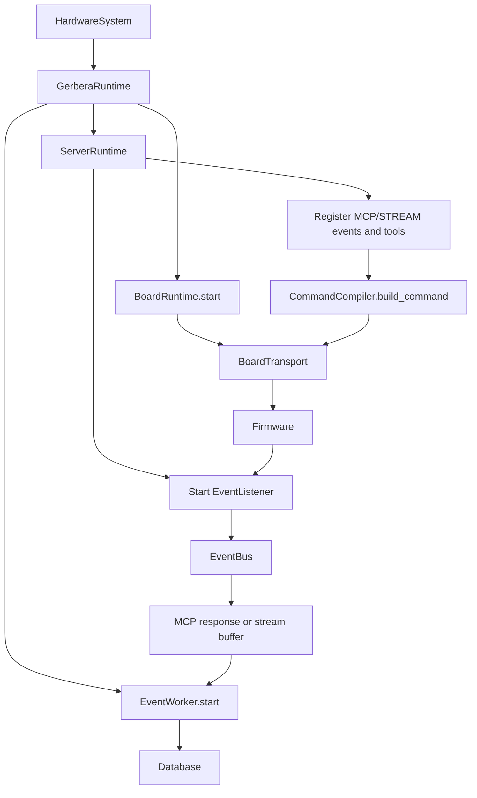

# Runtime

The runtime folder owns the live server process around the declared hardware graph.

It is responsible for:

- opening and closing serial connections
- registering MCP tools
- translating command specs into wire commands
- registering MCP and STREAM events
- starting and stopping listener threads
- coordinating stream flushing and database writes

It is not responsible for:

- defining the hardware graph itself
- device-specific firmware behavior
- pin modeling
- board/package metadata for compilation

## Boundaries

```text
boards/
    board_runtime.py            Board sessions, handshake and transport lifecycle.
    board_transport.py          Serial and Bluetooth transport implementations.
    serial_protocol.py          Wire message encoding and decoding.
commands/
    command_runtime.py          Command compilation and response parsing.
    command_response.py  Pending command correlation and completion.
perception/
    camera_runtime.py           Camera capture, latest-frame cache and lifecycle.
    model_runtime.py            Inference registration, output state and lifecycle.
movement/
    movement_runtime.py         Joint state, kinematics and motor coordination.
state/
    hardware_runtime.py         Connection state storage and snapshots.
storage/
    storage.py                  Stream schemas and bounded database startup wait.
server/
    server_runtime.py           MCP tools, resources, events and command dispatch.
    runtime_lifecycle.py        SDK preparation, resource startup and cleanup.
    readiness.py                Live dependency readiness reports.
```

`server` composes the runtime capabilities and owns their startup order. The other
folders own the board, command, perception, movement, state and persistence behavior
that the server uses. Hardware declarations remain under `models/hardware`.

## Ownership

`GerberaRuntime` owns:

- composing the SDK-owned preparation and lifecycle
- resolving the database and constructing one event worker for stream writes

`ServerRuntime` owns:

- MCP app/tool registration
- event registration
- building the nested runtime event catalog used by agents
- event listener health/tool exposure (lifecycle belongs to `RuntimeLifecycle`)
- binding executable actions onto connections
- command dispatch through board transport

`RuntimeLifecycle` owns storage preparation, firmware verification and resource
startup/shutdown order. Every normal SDK server startup uses it, independently of
the CLI. Cleanup callbacks are registered before starting dependencies so partial
startup failures and interruptions release already-owned resources.

`RuntimeReadiness` checks lifecycle phase, board sessions/listeners, cameras,
inference failures and event-worker health. `/ready` returns 503 while unavailable
and 200 when ready; it is distinct from HTTP liveness. The CLI polls these reports
without reproducing SDK validation or examining device state itself.

`BoardRuntime` owns:

- opening one configured transport per microcontroller
- looking up the active transport for a board
- closing and reconnecting active transports

`CommandCompiler` owns:

- reading command specs from device builders
- validating and serializing command parameters
- parsing firmware response payloads
- building command descriptions for MCP tools

## Runtime Flow



## Boundary Reaction

The runtime layer should know how the system runs.

The hardware layer should only know what the system is.

If a class needs to start threads, open ports, register MCP tools, or configure the event worker, it belongs in runtime rather than hardware.
